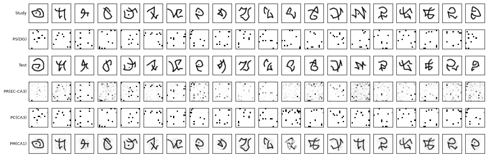
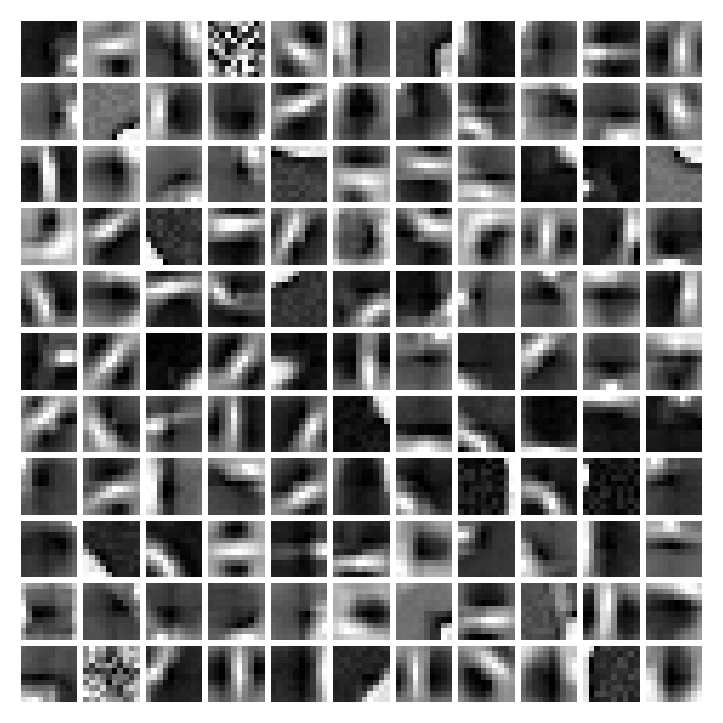

# AHA: an Artificial Hippocampal Algorithm in PyTorch

AHA is a model of the hippocampus that learns a new drawing from one look, with no labels. It comes from Kowadlo, Ahmed and Rawlinson (2019), who pair a slow-learning vision network with a fast-learning short-term memory built from four parts named after hippocampal regions. This repo is my PyTorch implementation of it, tested on the paper's one-shot benchmark with Omniglot, a set of handwritten characters from 50 alphabets.



*One-shot run 1. Rows from top: the 20 drawings AHA studies, the sparse pattern stored for each, new drawings of the same characters by a different person, what pattern retrieval brings back, the Hopfield memory it settles on, and the image it recalls. 16 of 20 columns recall the right character.*

## Results

The paper names each part as Function(Brain region). The regions are the entorhinal cortex (EC), the main link between the neocortex and the hippocampus, the dentate gyrus (DG), and two fields of the hippocampus proper, CA3 and CA1. VC(EC) is the vision network. The four hippocampal parts are PS(DG) for pattern separation, PC(CA3) for pattern completion, PR(EC-CA3) for pattern retrieval and PM(CA1) for pattern mapping. PC(CA3) is a Hopfield network, a memory that settles a noisy input onto the closest pattern it has stored. A table further down maps each part to its code.

The benchmark is Lake et al.'s one-shot classification test (2015). There are 20 runs. In each run the model studies 20 handwritten characters from one alphabet, then sees 20 new drawings of those characters by a different person. Chance is 5%. Like the paper, I score each stage of the model by matching on minimum mean squared error (MSE) and average over the runs. The paper (p8) presents one study character and asks for its match among the 20 test drawings, so each study drawing looks for its closest test drawing. Every run starts from a freshly initialised short-term memory, and the whole set repeats over 10 seeds.

| Stage scored | What it measures | This repo | Paper |
|---|---|---|---|
| Raw pixels | Floor for comparison | 44.2% | not reported |
| VC(EC) alone | Vision network only, the paper's baseline | 52.2% | 71.6% |
| PR(EC-CA3) | AHA, the paper's headline number | **64.7% ± 1.2** | **86.4%** |
| PC(CA3) | AHA after the Hopfield memory settles | 61.6% ± 0.9 | "no better than" the baseline |
| PM(CA1) | AHA's recalled image | 61.9% ± 0.7 | not reported |

My result is lower than the paper's. AHA scores 64.7% here against 86.4% reported, and the vision network alone scores 52.2% against 71.6%. AHA adds about 12 points over vision alone, where the paper reports about 15, so most of the gap is in the vision network, before AHA's memory gets involved. The next section measures how far the details the paper leaves open can close it.

Numbers come from `results/oneshot.json`: 10 seeds on an Apple M-series GPU through MPS, about 3 minutes when run alone. A one-seed run on the CPU gives the same accuracy as the matching MPS seed at every stage but PM, where one of 400 classifications differs (`results/cpu_seed0.json`).

Seeds set the hippocampal parts only. The vision network comes from one pretrained checkpoint, so its score has no spread across seeds. The paper says "every test is repeated with 10 random seeds" without saying whether pretraining is repeated too. The pretraining-seed rows below vary it.

## Closing the gap

Each row changes one or two details the paper leaves open, or reads two ways. Every row uses the same 10 seeds. Rows marked "seeds 0, 1 and 2" repeat all 10 seeds on three vision networks pretrained with different seeds, and their ± is the spread across those three networks. Everywhere else ± is the spread across the 10 seeds.

| Setting | Matching | VC(EC) | PR(EC-CA3) | PC(CA3) | PM(CA1) |
|---|---|---|---|---|---|
| Default: study-to-test, raw scale | study-to-test | 52.2% | 64.7% ± 1.2 | 61.6% ± 0.9 | 61.9% ± 0.7 |
| Test-to-study matching, the repo's first version | test-to-study | 56.0% | 61.3% ± 0.9 | 62.5% ± 0.8 | 61.5% ± 0.9 |
| Normalised matching, the best configuration found | study-to-test, normalised | 63.0% | 70.6% ± 1.4 | 61.5% ± 0.7 | 62.5% ± 1.1 |
| Normalised matching, test-to-study | test-to-study, normalised | 67.3% | 63.2% ± 1.2 | 62.5% ± 0.8 | 61.7% ± 0.8 |
| VC output normalised before DG and PR | study-to-test | 63.0% | 66.0% ± 1.1 | 61.5% ± 1.4 | 61.3% ± 0.9 |
| VC output normalised before DG and PR, normalised matching | study-to-test, normalised | 63.0% | 70.3% ± 1.5 | 61.3% ± 1.4 | 61.9% ± 1.0 |
| Default, VC pretrained with seeds 0, 1 and 2 | study-to-test | 54.4% ± 1.9 | 67.1% ± 2.0 | 63.0% ± 1.3 | 63.0% ± 1.0 |
| MSE pretraining | study-to-test | 54.0% | 59.3% ± 1.7 | 53.3% ± 1.9 | 54.4% ± 1.4 |
| MSE pretraining, normalised matching | study-to-test, normalised | 59.0% | 63.8% ± 1.2 | 53.2% ± 1.7 | 54.5% ± 1.3 |
| MSE pretraining, seeds 0, 1 and 2 | study-to-test | 54.6% ± 1.7 | 60.2% ± 1.2 | 53.6% ± 1.6 | 54.6% ± 1.9 |
| MSE pretraining, no interest filter | study-to-test | 57.7% | 57.1% ± 1.6 | 23.2% ± 2.6 | 30.0% ± 1.6 |
| MSE pretraining, VC output normalised before DG and PR, normalised matching | study-to-test, normalised | 59.0% | 63.9% ± 1.5 | 53.2% ± 2.1 | 54.3% ± 1.6 |
| Normalised matching, VC pretrained with seeds 0, 1 and 2 | study-to-test, normalised | 63.2% ± 0.1 | 72.0% ± 1.2 | 62.9% ± 1.3 | 63.6% ± 1.0 |

Normalised matching moves the score most. Dividing each vector by its length before taking the MSE lifts vision alone from 52.2% to 63.0%, and AHA from 64.7% to 70.6%. Without it, a drawing with more ink makes a longer vision vector, and at raw scale that length can outweigh which strokes are present. The authors' later PyTorch code ([Cerenaut/pt-aha](https://github.com/Cerenaut/pt-aha)) normalises the vision output this way. The paper doesn't mention it.

Matching direction moves stages in opposite ways. Going study-to-test, as the paper describes, raises AHA by 3.4 points and lowers vision alone by 3.8. pt-aha matches the vision network and CA3 study-to-test, and PR test-to-study. Under that mix, with normalised matching, the scores here would be VC 63.0% and PR 63.2%. The highest vision-alone score in the table, 67.3%, comes from normalised test-to-study matching.

Feeding normalised vectors into DG and PR adds little once matching is normalised (70.3% against 70.6%). DG ranks its inputs within each drawing and has no bias, so it picks the same winners either way, and only PR sees a change.

Pretraining with MSE, pt-aha's loss, lowers every hippocampal stage. Across three pretraining seeds AHA scores 60.2% with MSE against 67.1% with binary cross-entropy. Vision alone barely changes (54.6% against 54.4%). Without the interest filter, MSE vision reaches 57.7%, but the Hopfield stage falls to 23.2% there. The pretraining seed moves AHA more than I expected: across three seeds AHA ranges from 64.7% to 68.5%, and the shipped checkpoint, seed 0, is the lowest of the three.

**Best configuration found.** Normalised study-to-test matching with the default checkpoint scores 70.6% for AHA and 63.0% for vision alone. Across three pretraining seeds it scores 72.0% ± 1.2 for AHA, from 70.6% to 72.9%. I picked it by looking at the test scores in this table. Omniglot's one-shot runs have no separate validation set, so 70.6% is the best these options reach on a test I looked at while choosing. It is neither a held-out result nor the paper's method.

**What remains unexplained.** With the best configuration, AHA sits about 16 points below the paper (14 averaged over three pretraining seeds) and vision alone about 9 below (4 below with normalised test-to-study matching). AHA adds about 8 points over vision alone here, against the paper's 15. Under normalised matching, PC(CA3) scores a little below vision alone, which agrees with the paper's finding that it is "no better than" the baseline. The remaining gap is most likely in the vision network, since none of these options lifts it past 67.3%. Details I haven't tested are listed under "What differs from the paper" below.

## Ablations

Each row uses the same 10 seeds, the same pretrained vision network and study-to-test matching at raw scale.

| Setting | Matching | VC(EC) | PR(EC-CA3) | PC(CA3) | PM(CA1) |
|---|---|---|---|---|---|
| No interest filter | study-to-test | 53.8% | 52.5% ± 1.0 | 18.3% ± 1.6 | 26.1% ± 1.7 |
| No centring of drawings | study-to-test | 29.8% | 41.3% ± 1.5 | 38.1% ± 1.1 | 37.6% ± 0.9 |
| Hebbian learning in CA3 instead of pseudo-inverse | study-to-test | 52.2% | 64.7% ± 1.2 | 5.8% ± 0.5 | 5.8% ± 0.6 |

Turning off the interest filter barely changes vision alone but drops the Hopfield stage to 18%. With Hebbian learning, CA3 falls to chance: every stored pattern shares most of its -1 units with every other, and Hebbian weights can't keep patterns that similar apart. The no-centring row uses a vision network pretrained without centring.

Every table in this README is built from the JSON files in `results/` by `scripts/make_tables.py`, which also writes `results/tables.md` and `results/grid.csv`.

## How to run

Tested on Python 3.12. The scripts pick a device for you (`--device auto`: CUDA, then Apple MPS, then CPU), or you can pass `--device cpu`, `mps` or `cuda`.

```bash
python3.12 -m venv .venv
source .venv/bin/activate
pip install -r requirements.txt
pytest                      # 44 tests, a few seconds
```

Omniglot and the 20 one-shot runs download into `data/` on first use.

**Evaluate.** A pretrained vision network ships in `checkpoints/vc_pretrained.pth.tar` (51 KB, filters only), so you can skip pretraining.

```bash
python evaluate.py --seeds 10                      # writes results/oneshot.json
python evaluate.py --normalise                     # L2-normalise vectors before matching
python evaluate.py --match test-to-study           # the other matching direction
python evaluate.py --normalise-input               # normalise the VC output before DG and PR
python evaluate.py --no-interest-filter           # ablation; also --ca3-rule hebbian
```

`--checkpoint` takes one or more files. With several, each runs all the seeds and the summary spreads across them.

**Pretrain.** Trains the vision network on the 30 background alphabets: 2000 batches of 128, about 2 to 3 minutes on MPS. By default it overwrites the shipped checkpoint and saves `figures/vc_filters.png`.

```bash
python pretrain.py --seed 0
python pretrain.py --seed 1 --name vc_bce_s1       # another pretraining seed
python pretrain.py --loss mse --name vc_mse_s0     # MSE on a linear output, as in pt-aha
```

For the no-centring ablation, pretrain with `--no-centre --name vc_nocentre`, then evaluate with `--no-centre --checkpoint checkpoints/vc_nocentre.pth.tar`.

**Rerun everything.** `bash scripts/run_grid.sh` pretrains the extra vision networks, reruns every row in this README and rebuilds the tables. It takes about 85 minutes on an M-series Mac, one job at a time. `python scripts/make_tables.py` rebuilds the tables alone.

**Train.** In AHA the hippocampal parts train inside every test: they study a set once, get tested, and get wiped. `train.py` runs one of those cycles on one run, prints each stage's accuracy and saves the picture at the top of this page.

```bash
python train.py --run 1    # writes figures/aha_run01.png
```

## How the code maps to the paper

| Code (`model/modules.py`) | Paper part | What it does | Size |
|---|---|---|---|
| `ECPretrain`, `EC` | VC(EC), Vision Component | Sparse convolutional autoencoder. Learns stroke-like filters on other alphabets, then stays frozen. This is the long-term memory. | 121 filters, 10x10. Output 121 x 13 x 13 = 20449 |
| `InterestFilter` | Part of VC(EC) | Keeps the vision code only near the strongest edges, so blank page stops dominating | Up to 40 points per drawing |
| `DG` | PS(DG), Pattern Separation | Fixed random layer that gives each drawing its own sparse pattern, even near-duplicates | 225 units, 10 active |
| `CA3` | PC(CA3), Pattern Completion | Hopfield network that stores the DG patterns in one step and settles a noisy cue onto the closest one | 225 units |
| `ECToCA3` | PR(EC-CA3), Pattern Retrieval | Learns to map a vision code to its DG pattern, so a new drawing of a studied character finds its memory | 20449 to 1000 to 225 |
| `CA1` | PM(CA1), Pattern Mapping | Turns a CA3 pattern back into an image | 225 to 100 to 2704 (52 x 52) |

`model/aha.py` wires them together. During study, DG makes a pattern for each drawing, CA3 stores it, PR learns vision code to pattern, and CA1 learns pattern to image. During recall, PR turns a new drawing into a cue, CA3 settles, and CA1 draws what it remembers.



*The 121 filters the vision network learns on the background alphabets. Most are pen strokes: edges, curves and junctions.*

## What differs from the paper

- **Centring.** Each drawing is shifted so its centre of ink sits mid-frame. The paper doesn't mention this, but the authors' later PyTorch code ([Cerenaut/pt-aha](https://github.com/Cerenaut/pt-aha)) does it, and it moves every score a lot (see ablations).
- **Matching direction.** The paper (p8) presents one study character and asks for its match among 20 test characters, so matching runs study-to-test by default. The first version of this repo went test-to-study, which scored AHA 61.3% and vision alone 56.0%. `--match test-to-study` keeps that option.
- **Scale before matching.** The paper matches on MSE and says nothing about scale. pt-aha divides each vision vector by its length. Here that is `--normalise`, off by default, and it lifts vision alone to 63.0% and AHA to 70.6%.
- **Scale of the vision code fed to DG and PR.** pt-aha also feeds the normalised vector into the hippocampal parts. Here that is `--normalise-input`, off by default. It gives AHA 66.0%, or 70.3% with normalised matching.
- **Interest filter order.** Appendix B.3 leaves the order of masking and blurring open. I mask the vision code at the interest points, then blur, then max-pool. Kernel sizes come from Table 3. The authors' later PyTorch code has this filter but leaves it switched off.
- **Pretraining loss.** The paper doesn't name one. I use binary cross-entropy on the reconstruction. pt-aha uses MSE on a linear output, which is `pretrain.py --loss mse` here. With MSE, AHA drops to 59.3% and the Hopfield stage to 53.3%, while vision alone moves from 52.2% to 54.0%.
- **Lifetime sparsity.** During pretraining each filter also keeps its single strongest response anywhere in the batch, one position in one drawing. Appendix B (p17) calls this a "lifetime of 1 sample per mini-batch", which could also mean a filter keeps its whole response map on its best drawing. I haven't tested that reading.
- **PR hidden layer.** 1000 units, from Table 3. The paper's Figure 13 says 800.
- **PM output size.** The paper disagrees with itself here. Table 3 gives PM an output of 100, while Figure 13 and the text give 2704, one unit per pixel of a 52 x 52 image. I follow Figure 13.
- **DG output.** On p5 the paper writes DG's output as y = M·z, which keeps the winning values. My DG outputs 1 for each winner and 0 elsewhere. CA3 stores the sign of the pattern either way, so the stored memory would only differ where a winning value is zero or negative. PR's training target would change. I haven't measured it, and I expect a small effect.
- **Padding.** A 10-wide filter can't be padded evenly. At stride 5 I pad 4 on each side, which maps 52 to 11 and back to 52. At stride 1 I pad 4 before and 5 after to keep 52 x 52.
- **DG inhibition.** The paper's formula for the refractory period reads two ways. I fully inhibit a unit when it fires and let the inhibition decay by 0.95 with each new drawing.
- **Hopfield cue offset.** Appendix A.2 shifts the cue so at least k units are positive. I shift only when fewer than k are, and centre zero between the kth and (k+1)th values.
- **CA1 training input.** CA1 learns from the stored CA3 patterns during study. The paper doesn't say whether it trains on those or on recalled ones.
- **States compared for matching.** For PR(EC-CA3) I compare its output on the study drawings, after learning, with its output on the test drawings. For PC(CA3) I compare the stored pattern with the state the network settles into.
- **Seeds.** Seeds vary the hippocampal parts only, so vision alone has no spread across them. The paper repeats every test with 10 random seeds and doesn't say whether pretraining is repeated too. Rows marked "seeds 0, 1 and 2" vary pretraining.
- **Scope.** Only one-shot classification without noise or occlusion. The paper's instance-classification task, its noise and occlusion curves, and its FastNN baseline are not here.

## Credit

AHA is the work of Gideon Kowadlo, Abdelrahman Ahmed and David Rawlinson: [AHA! an 'Artificial Hippocampal Algorithm' for Episodic Machine Learning](https://arxiv.org/abs/1909.10340) (arXiv 1909.10340, 2019). Omniglot and the one-shot runs come from Brenden Lake and colleagues ([brendenlake/omniglot](https://github.com/brendenlake/omniglot)).

Thanks to Gideon Kowadlo and David Rawlinson for guiding me through some of the harder parts of the model, and to @ptrblck on the PyTorch forums for walking me through some of the more confusing parts of PyTorch.

## License

MIT, see [LICENSE](LICENSE).
